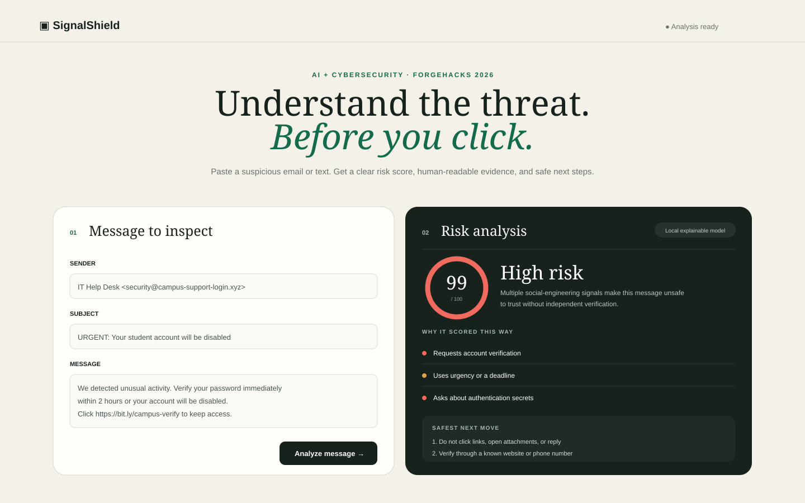
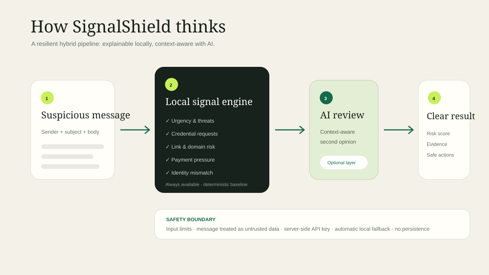

# SignalShield

> Understand the threat before you click.

**ForgeHacks 2026 track:** AI + Cybersecurity

SignalShield is an explainable phishing triage assistant for students, volunteers, and small organizations without a dedicated security team. Paste a suspicious email or text and get a 0–100 risk score, evidence you can understand, and safe next steps.



## Why it matters

Phishing detection tools often produce a red or green badge without teaching the user what made the message dangerous. SignalShield closes that gap. It identifies manipulation patterns, suspicious links, sender-domain mismatches, and credential or payment requests, then explains each signal in plain language. This helps a user make a safer choice now and recognize the pattern next time.

## What makes the AI meaningful

SignalShield uses a hybrid pipeline rather than sending raw text to a chatbot:

1. A local, deterministic analyzer extracts security signals and establishes a reproducible baseline.
2. When `OPENAI_API_KEY` is configured, a language model evaluates the interaction between those signals and the message context.
3. A constrained response contract turns the assessment into a risk score, evidence, and three safe actions.
4. If the external service is unavailable, the local model keeps the product fully usable.

The email is explicitly delimited as **untrusted data** in the model prompt. The model is told not to obey instructions contained inside it, reveal secrets, or recommend clicking/replying. API keys remain server-side.

## Quick start

Requirements: Node.js 20 or newer. There are no runtime dependencies.

```bash
git clone https://github.com/YOUR_USERNAME/signalshield.git
cd signalshield
npm start
```

Open [http://localhost:3000](http://localhost:3000). Click **Phishing alert**, then **Analyze message** for the fastest demo.

### Enable AI-assisted analysis (optional)

PowerShell:

```powershell
$env:OPENAI_API_KEY="your-key"
$env:OPENAI_MODEL="gpt-5-mini"
npm start
```

Without a key, the app clearly labels results as **Local explainable model**. This zero-setup mode is intentional so reviewers can test the core product immediately.

## Test

```bash
npm test
```

The tests cover phishing detection, benign-message handling, and the prompt-injection boundary.

## Architecture



- **Client:** accessible responsive HTML, CSS, and JavaScript
- **Server:** dependency-free Node HTTP server and validation layer
- **Local signal model:** explainable weighted rules for language, links, sender identity, and coercion patterns
- **AI reasoning:** OpenAI Responses API for context-aware second opinion
- **Resilience:** automatic local fallback when no API key is present or the AI call fails

See [docs/SUBMISSION.md](docs/SUBMISSION.md) for the complete written project description and [docs/DEMO_SCRIPT.md](docs/DEMO_SCRIPT.md) for a timed 3-minute recording plan.

## Responsible use

SignalShield is decision support, not a guarantee and not a replacement for professional incident response. It avoids certainty language, recommends independent verification, does not store analyzed messages, limits input size, escapes rendered output, keeps credentials off the client, and treats analyzed content as hostile.

## Roadmap

- Browser extension and share-sheet integration
- Organization-specific trusted-domain policies
- Feedback loop for false positives and confirmed campaigns
- Multilingual analysis and SMS screenshot OCR
- Aggregate, privacy-preserving campaign alerts

## License

MIT
